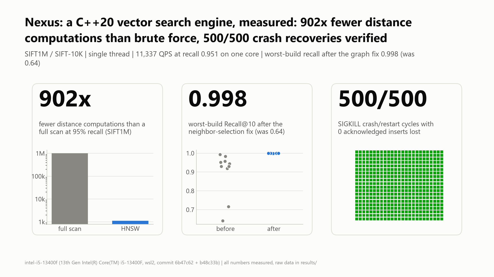

# Nexus Vector Database Engine

Nexus is an embedded C++20 vector search engine. It provides approximate nearest neighbor (ANN) search over dense FP32 vectors using a hierarchical navigable small world (HNSW) graph, AVX2/FMA distance kernels, 8-bit scalar quantization (SQ8) with exact re-ranking, and a CRC32-C-protected write-ahead log (WAL). The engine is built as a static library, `engine_core`, and is also packaged as a standalone HTTP service, `nexus_server`, which serves a React and Three.js dashboard.

Author: orel shushan

## Benchmarks

<picture>
  <source media="(prefers-color-scheme: dark)" srcset="docs/figures/hero_dark.png">
  
</picture>

Measured on one machine (Intel Core i5-13400F, WSL2 Ubuntu 26.04, GCC 15.2, `-O3 -mavx2 -mfma`), single thread unless
noted, k = 10. Every number below comes from a run whose raw JSON is in
[`results/intel-i5-13400f/2026-11-07/`](results/intel-i5-13400f/2026-11-07/). hnswlib v0.8.0 was built with the same
compiler and flags, ran on the same pinned vCPU, and was tuned on the same (M, efConstruction) grid. Each cell is the
fastest measured point at or above the recall target, with no interpolation.

| SIFT1M (1M x 128, L2)            | Nexus HNSW       | hnswlib          | Nexus / hnswlib |
|----------------------------------|------------------|------------------|-----------------|
| QPS at recall >= 0.90            | 16,032           | 17,253           | 0.93x (loss)    |
| QPS at recall >= 0.95            | 11,337           | 10,619           | 1.07x           |
| QPS at recall >= 0.99            | 5,607            | 4,916            | 1.14x           |
| Distance computations per query at recall >= 0.95 | 1,109 (902x fewer than a full scan) | 1,250 | 0.89x |
| Build time, M=16 efC=200 (median of 3) | 297 s      | 269 s            | 1.10x slower    |
| Memory, bytes per vector         | 680              | 718              | 0.95x           |

| GloVe-100 (1.18M x 100, angular) | Nexus HNSW | hnswlib | Nexus / hnswlib |
|----------------------------------|------------|---------|-----------------|
| QPS at recall >= 0.90            | 2,984      | 3,134   | 0.95x (loss)    |
| QPS at recall >= 0.95            | 1,356      | 1,271   | 1.07x           |
| QPS at recall >= 0.99            | 438        | 461     | 0.95x (loss)    |

| Engine property | Measured |
|-----------------|----------|
| Crash recovery (SIGKILL at random moments) | 500 of 500 cycles verified, 0 acknowledged inserts lost, 125 of 125 injected torn tails truncated |
| WAL replay | 1,000,000 records (505 MiB) read and CRC-checked in 0.12 s |
| Durable insert rate (fsync per insert) | 212 inserts/s into HNSW (P50 4.5 ms); 11,567/s without fsync |
| Neighbor-selection fix, SIFT-10K, efSearch 64, 10 builds each | worst-build recall 0.641 before, 0.998 after |
| HNSW-SQ8 at recall >= 0.95 (SIFT1M) | 14,571 QPS (vs 11,337 FP32), at 808 vs 680 bytes per vector |
| Multi-thread search (SIFT1M, ef 64) | 8,521 QPS on 1 thread, peak 49,737 QPS at 12 threads |
| AVX2 vs scalar L2 kernel | 2.8x to 11.8x faster (d = 32 to 1024) |

Losses are listed, not hidden. hnswlib is faster in 3 of the 6 recall comparisons and builds 1.10x faster on SIFT1M.
Durable writes are bounded by one fsync per insert, with no group commit. Read throughput drops at 16 threads. Absolute
numbers belong to this machine and to WSL2.

- Visual report with methodology and caveats for every chart: [`docs/report.html`](docs/report.html) (download it and
  open it in a browser).
- Summary, losses and how to run the suite on another machine:
  [`results/intel-i5-13400f/SUMMARY.md`](results/intel-i5-13400f/SUMMARY.md)
- Benchmark methodology and reproduction: [`benchmarks/README.md`](benchmarks/README.md); decisions log:
  [`docs/DECISIONS.md`](docs/DECISIONS.md)

## Contents

1. System overview
2. Systems pillars
3. Architecture
4. Performance and telemetry
5. HTTP API reference
6. Deployment and native build
7. Repository layout

## 1. System Overview

| Component            | Implementation                                                                 |
|----------------------|--------------------------------------------------------------------------------|
| Language / standard  | C++20                                                                          |
| Index types          | `FlatIndex`, `QuantizedFlatIndex`, `HNSWIndex`, `HNSWIndexSQ8`                  |
| Metrics              | `L2` (squared Euclidean), `DotProduct` (negated for ranking), `Cosine` (1 - cos) |
| SIMD requirement     | AVX2 and FMA (index code paths call the AVX2 kernels unconditionally)           |
| Durability           | Append-only WAL, checked sync per record, CRC32-C via SSE4.2, torn-tail truncation |
| Snapshot             | Binary index serializer with per-index-type magic numbers; temp file, fsync, atomic rename |
| Service              | Blocking-socket HTTP/1.1 server, fixed worker pool, JSON over REST              |

The service binary builds a 128-dimensional `HNSWIndexSQ8` with the L2 metric over a registry of 100 built-in concept vectors, then opens the WAL and replays it into the index.

## 2. Systems Pillars

### 2.1 SIMD vector kernels

Source: `src/distance/simd_metrics.cpp`, `include/engine/distance/simd_metrics.hpp`.

Kernels operate on `__m256` (8 x FP32) registers using unaligned loads (`_mm256_loadu_ps`) and fused multiply-add (`_mm256_fmadd_ps`).

| Kernel                          | Main loop                                  | Notes                                                                 |
|---------------------------------|--------------------------------------------|-----------------------------------------------------------------------|
| `l2_distance_squared_avx2`      | 32 floats per iteration, 4 accumulators    | `_mm256_sub_ps` followed by FMA on the difference                      |
| `dot_product_avx2`              | 32 floats per iteration, 4 accumulators    | FMA on operand pairs                                                   |
| `cosine_distance_avx2`          | 16 floats per iteration, 2 accumulator sets | Dot product and both squared norms in one pass; throws on zero norm   |
| `quantized_l2_distance_sq_avx2` | 32 bytes per iteration, 4 accumulators     | `_mm256_cvtepu8_epi32` + `_mm256_cvtepi32_ps`, dequantizes with `fmadd(code, scale, min)` against an FP32 query |

Each kernel reduces its accumulators (`reduce_accumulators`), then processes remaining 8-wide blocks, then a scalar tail, so any dimension is supported. Horizontal reduction uses 128-bit extract/add/`_mm_movehl_ps`/`_mm_movehdup_ps`.

Memory layout: vector storage in the indexes uses `AlignedVector<float>`, backed by `AlignedAllocator` with 32-byte alignment (AVX2 register width). The kernels themselves use unaligned loads and do not require alignment.

Scalar reference implementations (`l2_distance_squared`, `dot_product`, `cosine_distance`, `src/distance/metrics.cpp`) exist as portable references. There is no runtime CPU dispatch: the HNSW, flat, and SQ8 index code call the `_avx2` kernels directly, so the library requires an AVX2/FMA-capable CPU and is compiled with `-mavx2 -mfma` (or `/arch:AVX2` on MSVC).

### 2.2 HNSW index topology

Source: `src/index/hnsw_index.cpp`, `src/index/hnsw_index_sq8.cpp`.

Parameters and defaults (both `HNSWIndex` and `HNSWIndexSQ8`):

| Parameter        | Default | Meaning                                                              |
|------------------|---------|----------------------------------------------------------------------|
| `M`              | 16      | Maximum neighbors per node on layers >= 1                            |
| `M0`             | 2 x M   | Maximum neighbors per node on layer 0 (32 by default)                |
| `efConstruction` | 200     | Candidate list width during insertion                                |
| `efSearch`       | 50      | Candidate list width at query time; runtime-adjustable via `set_ef_search` |
| `re_rank_factor` | 2.0     | `HNSWIndexSQ8` only; see section 2.3                                 |

Constructors reject a dimension of 0 and `M` below 2 with `std::invalid_argument` (`M` below 2 makes the level multiplier `1 / ln(M)` infinite or negative). `HNSWIndexSQ8` additionally requires a trained quantizer.

Structure:

- Node level is drawn as `floor(-ln(U) * (1 / ln(M)))` with `U` uniform in (0, 1]. The generator is a `std::mt19937` seeded from `std::random_device`, so graph structure is not deterministic across runs.
- Layer 0 adjacency is a flat `uint32_t` array with a fixed stride of `M0 + 1` per node (degree followed by neighbor ids). Upper layers are stored per node as `level * (M + 1)` entries.
- Internal ids are dense `uint32_t` indexes; user-visible `VectorId` (`uint64_t`) is mapped through an `ids_` table.
- Insertion: greedy descent with ef = 1 from the entry point down to the node's level, then at each level from `min(max_level, node_level)` to 0 a beam search with width `efConstruction` collects candidates. The new node's outgoing links are chosen from those candidates by the neighbor-selection heuristic below (up to `M` links per level), and a reverse link is added from each chosen neighbor.
- Neighbor selection: Algorithm 4 of the HNSW paper with `keepPrunedConnections`. Candidates are scanned in order of increasing distance to the base node; a candidate is kept only if it is closer to the base node than to every neighbor already kept, and discarded candidates fill any remaining slots. This spreads links across directions and preserves the long-range edges between clusters.
- Link maintenance: when a reverse link is added to a node that is already at capacity (`M` on layers >= 1, `M0` on layer 0), the node's existing neighbors plus the new one are re-selected with the same heuristic. An earlier implementation replaced only the single farthest neighbor, which left 45% to 55% of layer-0 nodes unreachable from the entry point in most builds; with the heuristic every layer-0 node was reachable from the entry point in all 8 builds checked (SIFT-10K, `M` = 16, `efConstruction` = 200), with no node of in-degree zero. A regression test (`RecallIsStableAcrossRandomBuilds` in `tests/test_hnsw.cpp` and `tests/test_hnsw_sq8.cpp`) builds six graphs over clustered data and fails on the earlier implementation (recall 0.33 to 0.57).
- Query: greedy descent through upper layers (hill climbing with a single entry point), then a best-first beam search on layer 0 with width `max(efSearch, k)`.
- Visited-set tracking uses a thread-local tag array, avoiding per-query allocation and clearing.
- There is no delete operation. `add` with an existing id appends a second node; ids are not deduplicated.

Shared graph core: `src/index/hnsw_common.hpp` holds the traversal and maintenance logic used by both `HNSWIndex` and `HNSWIndexSQ8`. It is a header of function templates parameterized by policy callables, so there is no virtual dispatch on the hot path and the compiler inlines each index's distance function into the loop:

| Primitive                | Responsibility                                                                                  |
|--------------------------|-------------------------------------------------------------------------------------------------|
| `search_layer_impl`      | Best-first beam search on one layer; takes link-access, distance, and prefetch callables         |
| `greedy_descend`         | Single-entry hill climb through the upper layers                                                |
| `select_neighbors_heuristic` | Diversity-based neighbor selection (HNSW Algorithm 4 with kept pruned connections)          |
| `add_link_impl`          | Append a neighbor; if the list is full, re-select the neighbors plus the new one with the heuristic |
| `connect_new_node`       | Heuristic selection of the new node's neighbors and bidirectional linking                         |
| `VisitedList`            | Thread-local epoch-tagged visited set shared by both index types                                 |

Each index supplies only its storage layout and metric dispatch: `HNSWIndex::distance_to` over FP32 vectors, and `HNSWIndexSQ8::compute_quantized_distance` over SQ8 codes (L2) or raw FP32 (cosine, dot product).

Cache prefetching: inside `search_layer_impl`, before distances are evaluated for the neighbors of an expanded node, a first pass issues `_mm_prefetch(..., _MM_HINT_T0)` for each unvisited neighbor's vector data (up to four 64-byte cache lines per vector; the SQ8 index prefetches the 8-bit codes for L2 and the raw floats for the other metrics). This overlaps the dependent cache misses of the pointer-chasing traversal. Measured on SIFT1M (one saved graph, a build with and a build without prefetching via the compile-time toggle `NEXUS_DISABLE_PREFETCH`, 5 alternating run pairs, Intel i5-13400F under WSL2): +2.3% to +10.0% QPS depending on efSearch, faster in 24 of 25 run pairs (`results/intel-i5-13400f/2026-11-07/ablation/`). The benefit depends on the memory system and may differ on other CPUs.

`HNSWIndex` is not internally synchronized; thread safety is provided by `VectorEngine` (section 2.5).

### 2.3 SQ8 quantization pipeline

Source: `src/quantization/scalar_quantizer.cpp`, `src/index/hnsw_index_sq8.cpp`.

Training (`ScalarQuantizer::train`): a single pass computes the per-dimension minimum and maximum over the training set (AVX2 `_mm256_min_ps` / `_mm256_max_ps`). Per dimension:

```
scale[d] = (max[d] - min[d]) / 255        (scale = 1.0 when range < 1e-7)
code[d]  = clamp((x[d] - min[d]) / scale[d] + 0.5, 0, 255)    truncated to uint8
decode   = min[d] + code[d] * scale[d]
```

`encode` and `decode` throw if the quantizer is untrained or sizes mismatch. `HNSWIndexSQ8` requires a trained quantizer at construction. Values outside the training range saturate at 0 or 255.

Search flow in `HNSWIndexSQ8`:

1. Graph traversal, construction, and link pruning use the quantized distance for the L2 metric (FP32 query against dequantized codes). For Cosine and DotProduct the traversal uses the stored FP32 vectors.
2. Layer-0 search collects `max(efSearch, k) * re_rank_factor` candidates (100 by default).
3. Candidates are re-ranked by exact FP32 distance and the top `k` are returned, so returned distances are exact.

Memory footprint: `HNSWIndexSQ8` stores both the uint8 codes and the original FP32 vectors (`quantized_storage_` and `raw_storage_`), which is 5 bytes per component, not 1. The FP32 copy is required for re-ranking and for the Cosine/DotProduct paths. The 4x reduction (1 byte versus 4 bytes per component) applies to `QuantizedFlatIndex`, which stores only codes.

### 2.4 Write-ahead logging and crash recovery

Source: `src/storage/wal_manager.cpp`, `include/engine/storage/crc32.hpp`.

Record layout (little-endian on x86-64, native byte order via `std::bit_cast`):

```
offset  size  field
0       1     op type            0x01 = Insert (the only defined operation)
1       4     CRC32-C            over bytes [5, 5 + payload_len)
5       8     vector id          uint64
13      4     dimension          uint32
17      4*d   vector payload     d FP32 values
17+4*d  1     end marker         0xAA
```

Record size is `18 + 4*d` bytes. The log has no file header and no magic number.

Checksum: CRC32-C (Castagnoli) computed with the SSE4.2 instructions `_mm_crc32_u64` and `_mm_crc32_u8`, initial value `0xFFFFFFFF`, final XOR `0xFFFFFFFF`. The CRC covers the id, dimension, and vector payload; it does not cover the op byte or the end marker.

Write path: `append_insert` rejects dimensions of 0 or above `MAX_SUPPORTED_DIM` (4096), serializes the record into a reusable buffer, issues one `fwrite`, flushes the C buffer, and then synchronizes with `fdatasync` (POSIX) or `FlushFileBuffers` (Windows). The return value of the OS call is checked: a failure is logged to stderr and raised as `std::system_error` carrying the OS error code, so an unsynchronized write is never reported as durable. `VectorEngine::insert` validates the vector dimension against the index, appends to the WAL, and then applies the vector to the in-memory index.

Replay (`WalManager::replay`, invoked from the `VectorEngine` constructor) reads records sequentially and applies each through the index's `add`. The dimension field is range-checked before any buffer is sized, so a corrupted length cannot trigger a large allocation; the CRC is verified over the complete payload before the record is applied.

| Condition                                              | Behavior                                                          |
|--------------------------------------------------------|-------------------------------------------------------------------|
| Clean end of file                                      | Replay ends normally                                              |
| Truncated header (fewer than 17 bytes)                 | Torn tail: logged, file truncated to the last valid record        |
| Truncated vector payload or missing end marker         | Torn tail: logged, file truncated to the last valid record        |
| Unknown op type byte                                   | Throws `std::runtime_error`                                       |
| Dimension of 0 or above `MAX_SUPPORTED_DIM`            | Logged; throws `std::runtime_error`                               |
| End marker present but not equal to `0xAA`             | Throws `std::runtime_error`                                       |
| CRC32-C mismatch on a complete record                  | Throws `std::runtime_error`                                       |

Torn-tail recovery: a crash during an append leaves an incomplete record at the physical end of the log. Replay stops at the last verified record and truncates the file to that byte offset (`ftruncate`, or `_chsize_s` on Windows) so that subsequent appends do not follow garbage. A record that is complete but fails validation is treated as hard corruption and aborts replay; the server does not catch the exception during startup, so the process terminates and the log must be repaired or removed by an operator. A bad dimension field is always treated as hard corruption, even at the tail of the log.

Checkpointing (`VectorEngine::create_checkpoint`) writes the snapshot through `Serializer::save`, which writes to `<path>.tmp`, flushes and synchronizes the file (`fsync` / `_commit`), and then renames it over the target. A crash at any point leaves either the previous snapshot or the new one, never a partial file; on failure the temporary file is removed. After the rename, the parent directory entry is made durable: on POSIX the directory is opened (`O_RDONLY | O_DIRECTORY`) and `fsync`ed, so the new name survives sudden power loss; on Windows, where directories cannot be flushed, the replacement uses `MoveFileExW` with `MOVEFILE_REPLACE_EXISTING | MOVEFILE_WRITE_THROUGH`, which returns only after the move has been written through. Both branches are built and exercised: the Windows branch by the native MinGW build, and the POSIX branch by the Linux (Ubuntu 24.04, GCC) build inside the `test` stage of the `Dockerfile`, which runs the checkpoint tests. Their power-loss behavior itself has not been tested. After the snapshot, the WAL is truncated (`clear`, which reopens the file with `"wb+"`). The checkpoint holds the WAL mutex for its whole duration, and `insert` holds the same mutex across both the WAL append and the index update, so an acknowledged insert is always either in the snapshot or in the WAL that survives it. Snapshot files begin with a 32-bit magic (`VECI` flat, `HNSW`, `SQ8H`) and a version field (currently 1). On startup, `nexus_server` loads `index.bin` if it exists in the working directory, otherwise it builds the default concept index. Loading treats the file as untrusted: vectors are read in bounded chunks so a corrupted length field cannot trigger a large allocation, truncation is an error at any offset, header parameters are range-checked, and the graph is validated before use (array lengths, adjacency degrees, neighbor ids, and that every neighbor listed on an upper layer owns that layer). A snapshot that fails validation raises `std::runtime_error`; `nexus_server` then reports the failure and starts from the built-in index.

### 2.5 Thread pool and concurrency model

Source: `src/server/WorkerThreadPool.*`, `src/server/HttpServer.cpp`, `src/core/vector_engine.cpp`.

- `HttpServer` runs a blocking accept loop. Each accepted connection is enqueued as a task. `main` creates the server with 4 worker threads.
- `WorkerThreadPool` is a fixed set of `std::thread` workers consuming a single `std::queue<std::function<void()>>` guarded by one `std::mutex` and a `std::condition_variable`. It is a plain FIFO pool; there is no work stealing and no per-thread queues. Destruction sets a stop flag, wakes all workers, and joins them after the queue drains.
- Each connection is handled as one request/response exchange (read until `Content-Length` bytes are received, route, send, close). There is no keep-alive. Request bytes are read in 4096-byte chunks; request size is capped: bodies larger than `MAX_BODY_SIZE` (16 MiB) are rejected with HTTP 413 as soon as `Content-Length` is parsed (or as soon as received bytes exceed the cap), and header blocks over 16 KiB with HTTP 431, so memory use per connection is bounded.
- `VectorEngine` uses two locks. `index_rw_lock_` (`std::shared_mutex`) allows concurrent `search` calls and gives `insert` exclusive access while it mutates the index. `wal_mutex_` serializes WAL appends. Insert acquires the WAL mutex, appends and syncs, then takes the exclusive index lock while still holding the WAL mutex (lock order: `wal_mutex_` then `index_rw_lock_`, identical in `create_checkpoint`). The fsync happens before the index lock is taken, so concurrent searches are not blocked by disk I/O, but inserts are fully serialized with one another and with checkpoints.
- Because both steps of an insert run under the WAL mutex, log order and index application order are identical, and replay reconstructs the same insertion sequence (node levels are re-randomized, so the graph topology differs).
- Failure isolation: `WorkerThreadPool::worker_loop` catches exceptions escaping a task and logs them, so a failing request cannot terminate a worker. `Router` maps `std::invalid_argument` to HTTP 400 and other engine exceptions to HTTP 500, with a catch-all around routing.
- Connection handling: the client socket is owned by an RAII guard, so every exit path (including an exception while parsing) closes it. Receives time out after 10 seconds, so a stalled client cannot hold a worker indefinitely. Responses are written with a send loop (`send` may transfer fewer bytes than requested), and `MSG_NOSIGNAL` is set on Linux so a client that disconnects mid-response cannot terminate the process with `SIGPIPE`.
- Shutdown: `is_running_` and the listening descriptor are `std::atomic`, because `stop()` may run on a different thread than `start()`. `stop()` calls `shutdown()` before closing the listening socket; on Linux `close()` alone does not wake a thread blocked in `accept()`.
- Input validation at the HTTP boundary: JSON vectors containing `nan`, `inf`, or values that overflow `float` are rejected with HTTP 400 (`VectorEngine` enforces the same rule for library callers, before anything is written to the WAL); `k` above 10000 is rejected with HTTP 400; result ids above 32 bits are never mapped onto the 100 built-in concept labels.

## 3. Architecture

```
  HTTP client / dashboard
          |
          v
  +-----------------------+      +-----------------------------------+
  | HttpServer            |      | WorkerThreadPool (4 threads)      |
  | blocking accept loop  +----->| single FIFO queue, mutex + condvar|
  +-----------------------+      +----------------+------------------+
                                                  |  one task per connection
                                                  v
                          +--------------------------------------------+
                          | HttpRequestParser -> Router                |
                          | JsonUtils (hand-rolled JSON in/out)        |
                          | StaticFileHandler (public/)                |
                          +-----+-------------------+------------------+
                       POST /api/search     POST /api/insert
                                |                   |
                                |                   v
                                |        VectorEngine::insert
                                |          1. wal_mutex_  -> WalManager::append_insert (held)
                                |             [op|crc32c|id|dim|floats|0xAA] + fdatasync
                                |          2. unique_lock(index_rw_lock_) -> index.add
                                |                   |
                                v                   v
                          +--------------------------------------------+
                          | HNSWIndexSQ8  (L2, dim 128 in nexus_server)|
                          |  insert: ScalarQuantizer::encode (uint8)   |
                          |          layered graph link (M=16, M0=32)  |
                          |  search: shared_lock(index_rw_lock_)       |
                          |    descent L_top..L1 (greedy, ef=1)        |
                          |    layer 0 beam search over SQ8 codes      |
                          |      -> quantized_l2_distance_sq_avx2      |
                          |    exact FP32 re-rank (l2_distance_squared |
                          |      _avx2) -> top-k                       |
                          +--------------------------------------------+

  Startup:   index.bin (if present) or built-in concept index
             -> WalManager::replay (verify CRC32-C, truncate torn tail) -> index.add per record
  Checkpoint: Serializer::save (index.bin.tmp, fsync, rename) -> WAL truncate
```

## 4. Performance and Telemetry

### 4.1 Latency instrumentation

- `POST /api/search` and `POST /api/insert` time the engine call with `std::chrono::steady_clock` and return the duration in microseconds as `took_us`. This measures the engine call only, excluding socket I/O, parsing, and JSON serialization.
- `GET /api/status` reports the engine dimension and live vector count.

### 4.2 Benchmark harness

`benchmarks/bench_sift.cpp` (target `bench_sift`) evaluates the SIFT-small dataset (10,000 base vectors, 128 dimensions, 100 queries, k = 10) against the provided ground truth. For each configuration it runs one scoring pass for recall and then 20 timed passes over all queries, timing every query individually, and reports Recall@10, P50, P99, mean latency, and single-thread QPS (1 / mean latency). It reads `data/siftsmall/siftsmall_base.fvecs`, `siftsmall_query.fvecs` and the ground-truth ivecs file relative to the working directory; `data/` is git-ignored.

Measured results below come from the benchmark suite (`benchmarks/nexus_bench.cpp` and `scripts/run_all.py`, which use the same protocol: one recall pass, then 20 timed passes over the 100 queries, each query timed individually). Machine: Intel Core i5-13400F, WSL2 Ubuntu 26.04, GCC 15.2 with `-O3 -mavx2 -mfma`, single thread pinned to one vCPU, HNSW M = 16, efConstruction = 200. HNSW rows are the median over 5 independent builds, with recall min - max across them. Raw data: `results/intel-i5-13400f/2026-11-07/recall_qps/siftsmall_*.json`. An earlier version of this table came from a different machine (AMD Ryzen AI 7 350, native Windows) and is superseded.

| Configuration                        | Recall@10 median (min - max) | P50 (us) | P99 (us) | QPS (1 thread) |
|--------------------------------------|------------------------------|----------|----------|----------------|
| `FlatIndex` (exact)                  | 1.000                        | 87.3     | 177.5    | 10,959         |
| `QuantizedFlatIndex`                 | 0.990                        | 106.6    | 170.4    | 9,139          |
| `HNSWIndex` ef = 16                  | 0.973 (0.972 - 0.978)        | 8.8      | 16.5     | 110,522        |
| `HNSWIndex` ef = 32                  | 0.997 (0.997 - 0.997)        | 16.2     | 26.8     | 62,214         |
| `HNSWIndex` ef = 64                  | 0.999 (0.999 - 0.999)        | 29.8     | 44.3     | 34,751         |
| `HNSWIndex` ef = 100                 | 1.000 (1.000 - 1.000)        | 43.6     | 64.8     | 23,482         |
| `HNSWIndex` ef = 150                 | 1.000 (1.000 - 1.000)        | 61.4     | 89.3     | 16,824         |
| `HNSWIndexSQ8` ef = 32, re-rank 1    | 0.997 (0.997 - 0.998)        | 19.1     | 30.4     | 52,147         |
| `HNSWIndexSQ8` ef = 32, re-rank 2    | 0.999 (0.999 - 0.999)        | 35.5     | 54.8     | 28,931         |
| `HNSWIndexSQ8` ef = 32, re-rank 5    | 1.000 (1.000 - 1.000)        | 77.0     | 111.2    | 13,398         |
| `HNSWIndexSQ8` ef = 64, re-rank 5    | 1.000 (1.000 - 1.000)        | 133.8    | 196.1    | 7,627          |
| `HNSWIndexSQ8` ef = 150, re-rank 5   | 1.000 (1.000 - 1.000)        | 262.3    | 347.9    | 3,824          |
| hnswlib v0.8.0 ef = 32 (reference)   | 0.994 (0.993 - 0.996)        | 12.5     | 21.6     | 80,384         |

Interpretation and limitations:

- Recall is stable across builds: over 5 builds the widest HNSW spread is 0.947 - 0.959 (ef = 10), and from ef = 24 up every build gives the same recall. With the commit before the neighbor-selection change (section 2.2), 10 builds at ef = 64 had a worst build of 0.641 in one pass and 0.394 in another; after it, 0.998 (`results/intel-i5-13400f/2026-11-07/before_after_fix/`).
- Against hnswlib on this 10,000-vector set, with one configuration (M = 16, efConstruction = 200) for both: at recall >= 0.90 hnswlib is faster (200,251 vs 164,979 QPS), at >= 0.95 Nexus is faster (164,979 vs 143,745), and at >= 0.99 they are level (78,507 vs 80,384). On SIFT1M with a tuned grid, see the Benchmarks section at the top.
- Graph traversal versus sequential scan: the base set is 10,000 x 128 x 4 B, about 5 MB, which fits in the last-level cache. An exact scan then streams contiguous memory that the hardware prefetcher handles well (87.3 us P50), while HNSW performs dependent, random-access hops, so its advantage here is about 5x (16.2 us at 0.997 recall). On SIFT1M (1M vectors) the measured gap at recall >= 0.95 is 11,337 vs 43 QPS. The explanation of the cache behavior is an interpretation of these numbers, not a separate measurement.
- `HNSWIndexSQ8` re-ranks the entire candidate pool collected on layer 0 (`max(efSearch, k) * re_rank_factor` candidates, all rescored with exact FP32 distances) before truncating to `k`; it does not truncate to `k` first. With a factor of 5 on this cache-resident dataset it is slower than brute-force `FlatIndex` at large efSearch. With re-rank 1 it reaches 0.997 recall at 52,147 QPS, and on SIFT1M it is faster than FP32 HNSW at equal recall (14,571 vs 11,337 QPS at >= 0.95), at 808 vs 680 bytes per vector.
- Scalar quantizer calibration was reviewed: `QuantizedFlatIndex` reaches 0.990 Recall@10 with plain per-dimension min/max bounds, so percentile clipping was not introduced.
- The query set is 100 vectors, the figures are single-thread latency rather than server throughput, and they were produced on one machine; they are not comparable with figures from other hardware or datasets.

### 4.3 Memory efficiency

| Structure             | Bytes per vector component | Notes                                                    |
|-----------------------|----------------------------|----------------------------------------------------------|
| `HNSWIndex`           | 4                          | FP32 only                                                |
| `QuantizedFlatIndex`  | 1                          | uint8 codes; 4x smaller than FP32                         |
| `HNSWIndexSQ8`        | 5                          | uint8 codes plus FP32 copy for re-ranking                |

Graph overhead is `(2M + 1) * 4` bytes per node on layer 0 (132 bytes at M = 16) plus `level * (M + 1) * 4` bytes for upper layers. Per-dimension quantizer parameters add `2 * d * 4` bytes in total.

## 5. HTTP API Reference

Base URL: `http://localhost:8080`. All handlers set `Access-Control-Allow-Origin: *`; `OPTIONS` requests return `204`. There are no WebSocket endpoints. Request bodies are parsed by a minimal hand-written JSON scanner (`src/server/JsonUtils.hpp`), not a general JSON parser.

| Method | Path              | Request body                                | Success response                                                                 |
|--------|-------------------|---------------------------------------------|----------------------------------------------------------------------------------|
| GET    | `/api/status`     | none                                        | `{"status":"ok","server":"...","engine_ready":true,"dimension":128,"total_vectors":N}` |
| GET    | `/api/concepts`   | none                                        | Precompiled JSON catalog `{"concepts":[...]}` of the 100 built-in concepts        |
| POST   | `/api/search`     | `{"vector":[floats], "k":10}` (`k` optional, default 10) | `{"status":"success","took_us":T,"k":K,"results":[{"id","distance"[,"label","branch","category"]}]}` |
| POST   | `/api/insert`     | `{"id":uint, "vector":[floats]}`            | `{"status":"success","message":"...","id":ID,"took_us":T}`                         |
| POST   | `/api/checkpoint` | none                                        | `{"status":"success","message":"Checkpoint created successfully and WAL truncated."}` |

Result entries include `label`, `branch`, and `category` only when the id matches a built-in concept (ids 1 to 100). Distances for the default L2 index are squared Euclidean distances.

Error responses:

| Status | Condition                                                                |
|--------|--------------------------------------------------------------------------|
| 400    | Body is not parseable as the expected JSON; the vector contains `nan`, `inf` or an overflowing value; `k` is above 10000; or the engine rejects the input with `std::invalid_argument` |
| 422    | Vector length differs from the engine dimension (message includes both)   |
| 413    | Request body larger than 16 MiB (`MAX_BODY_SIZE`)                         |
| 431    | Request headers larger than 16 KiB                                        |
| 500    | Engine error during search or insert, or `/api/checkpoint` failed (checkpoint messages include the exception text) |
| 503    | Engine not initialized                                                    |
| 404    | Unknown path and no matching file under `public/`                         |

Any other path is served as a static file from `public/`; `/` maps to `/index.html`.

Example:

```bash
curl -s http://localhost:8080/api/status
curl -s -X POST http://localhost:8080/api/search \
     -H 'Content-Type: application/json' \
     -d '{"k":5,"vector":[ ...128 floats... ]}'
```

## 6. Deployment and Native Build

### 6.1 Docker Compose

```bash
git clone <repo-url>
cd Vector_Database_Engine
docker compose up --build -d
```

The image is defined by the following stages (see the header of `Dockerfile`):

| Stage          | Purpose                                                                                           |
|----------------|---------------------------------------------------------------------------------------------------|
| `web-build`    | Node 20; builds the dashboard into `public/`                                                      |
| `toolchain`    | Ubuntu 24.04 with GCC, CMake, Ninja and git, plus the sources; base of every C++ stage             |
| `engine-build` | Ubuntu 24.04 with GCC, CMake and Ninja; Release build of every target with `-mavx2 -mfma -O3`    |
| `test`         | Runs `ctest --output-on-failure`; a failing test fails the image build                            |
| `bench`        | Entry point is `bench_sift`; the dataset is mounted at run time                                   |
| `asan`, `tsan` | Sanitizer builds that run the full test suite (section 6.2); not part of the default chain       |
| `runtime`      | `nexus_server`, `public/` and `libstdc++` only; the default target                                |

The `runtime` stage depends on the `test` stage, so `docker build -t vector-engine:latest .` compiles, runs the full test suite, and produces the runtime image only if every test passes. GoogleTest is fetched during the configure step, which requires network access. The host CPU must support AVX2 and FMA. The service listens on port 8080.

Build and run the service image directly:

```bash
docker build -t vector-engine:latest .
docker run --rm -p 8080:8080 -v "$(pwd)/data:/app/data" vector-engine:latest
```

Run the SIFT benchmark in a container (the `data/siftsmall/` files are git-ignored and must be present on the host):

```bash
docker build --target bench -t vector-engine:bench .
docker run --rm -v "$(pwd)/data:/src/data:ro" vector-engine:bench
```

Persistence: `./data` on the host is mounted at `/app/data`, and `/app/nexus.wal` is a symlink to `/app/data/nexus.wal`, so the WAL survives container replacement. The checkpoint file `index.bin` is written to the container working directory (`/app/index.bin`), which is not on the volume, so a checkpoint is lost when the container is recreated; because checkpointing also truncates the WAL, do not rely on `/api/checkpoint` for durability in the default compose configuration.

Operations: `docker compose logs --tail=30`, `docker compose ps`, `docker compose down`.

### 6.2 Native build

Prerequisites:

- CMake 3.25 or newer
- A C++20 compiler: GCC 13+, Clang 17+, or MSVC (the build adds `/arch:AVX2`)
- Ninja (optional; any CMake generator works)
- An x86-64 CPU with AVX2, FMA, and SSE4.2
- Node.js 20+ for the dashboard

```bash
cmake -B build -G Ninja -DCMAKE_BUILD_TYPE=Release
ninja -C build
./build/nexus_server          # run from a directory containing public/
```

Build and test status of the current tree: 82 of 82 tests pass (GoogleTest through CTest); a clean rebuild produces zero warnings under `-Wall -Wextra -Wpedantic` (GCC, MinGW and Ubuntu 24.04); the suite also passes under AddressSanitizer with UndefinedBehaviorSanitizer and under ThreadSanitizer (section 6.2).

Targets: `engine_core` (library), `nexus_server`, `vector_engine_app` (example), `bench_sift`. Unit tests live in `tests/` (GoogleTest, fetched at configure time by `FetchContent`) and are registered through CTest.

The server resolves `public/`, `nexus.wal`, and `index.bin` relative to its working directory.

Dashboard:

```bash
cd web
npm ci
npm run dev       # Vite development server
npm run build     # type-check and emit the bundle to ../public
```

Sanitizers: configure with `-DENABLE_ASAN=ON` (AddressSanitizer and UndefinedBehaviorSanitizer) or `-DENABLE_TSAN=ON` (ThreadSanitizer); the two are mutually exclusive and require GCC or Clang with the sanitizer runtimes. The development toolchain on Windows (MinGW) does not provide them, so both are run in the Linux container:

```bash
# AddressSanitizer + UndefinedBehaviorSanitizer (leak detection enabled): runs ctest during the build
docker build --target asan -t vector-engine:asan .

# ThreadSanitizer: the build compiles; the run needs ASLR disabled (see below)
docker build --target tsan -t vector-engine:tsan .
docker run --rm --security-opt seccomp=unconfined vector-engine:tsan
```

Results on the current tree (Ubuntu 24.04, GCC, Debug): all 82 tests pass under AddressSanitizer with UndefinedBehaviorSanitizer and under ThreadSanitizer, with no reports of memory errors, leaks, undefined behavior, or data races. The suite includes concurrent reads and writes against `VectorEngine`, end-to-end HTTP tests with `start()` and `stop()` on different threads, and a randomized snapshot-corruption test. ThreadSanitizer aborts at startup with "unexpected memory mapping" on kernels whose address-space randomization is wider than its shadow-memory layout (observed on the Docker Desktop kernel); running the tests with ASLR disabled (`setarch -R`, which requires `--security-opt seccomp=unconfined`) avoids this. Sanitizer coverage is limited to what the tests exercise.

### 6.3 Dashboard

The dashboard (`web/`, React 19, TypeScript, Vite, Three.js, GSAP) visualizes the 100 built-in concepts across four branches. Implemented capabilities:

- 3D scene (`web/src/scene/HoloTopology.ts`) with orbit camera controls, instanced meshes for concept nodes, raycast picking against an instanced pick mesh, and custom shader materials for conduits, packet animation, and result trails.
- Selecting a concept sends a `POST /api/search` with a query vector derived from that concept's branch and displays the returned neighbors and the engine-reported `took_us` latency.
- Status and vector count are read from `GET /api/status`; the concept catalog from `GET /api/concepts`.
- When the backend is unreachable, the UI falls back to a local simulation and labels itself as a standalone preview. Simulated results are not engine output.

## 7. Repository Layout

```
include/engine/       public headers: core, distance, index, quantization, storage
src/                  engine implementation (src/index/hnsw_common.hpp: shared HNSW graph core)
src/server/           HTTP server, router, worker pool, concept registry
web/                  React + Three.js dashboard (builds into public/)
benchmarks/           SIFT benchmark
examples/             embedded usage example
tests/                GoogleTest unit tests
Dockerfile            multi-stage image build
docker-compose.yml    service definition and volume mapping
```
